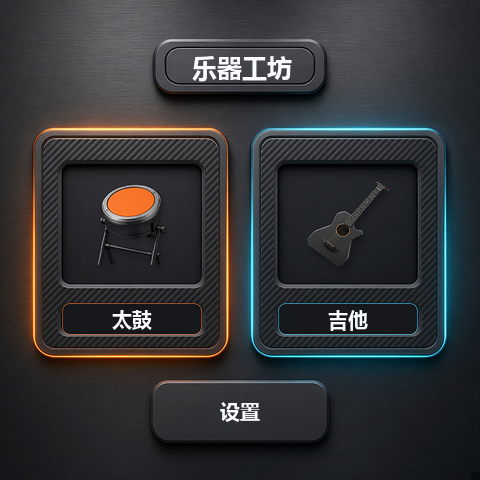
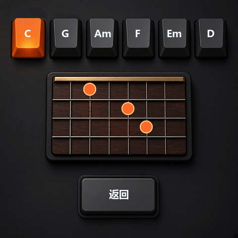
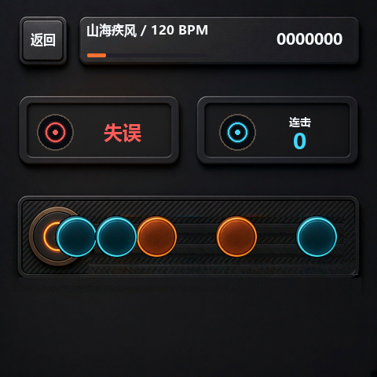

# 乐器工坊

在 ESP-Mosaico 上用 ToF 隔空演奏吉他，或打一首原创太鼓。界面为中英双语。曲目、鼓声和界面均为本应用自有资源，不含商业节奏游戏的名称、角色、谱面或美术。



## 能做什么

首页进入吉他或太鼓。

吉他用扩展槽上的 ToF 识别上扫和下扫，屏幕上选择和弦并微调音高，扬声器播放对应琴弦采样。

太鼓包含选曲、演奏和结算。音符沿音轨走向鼓面，击中鼓心或鼓边后给出判定、连击和分数，一曲结束停在结算页。内置三首原创曲：

- 《山海疾风》120 BPM
- 《朱雀夜奔》138 BPM
- 《破阵新声》156 BPM

伴奏在演奏过程中播放。鼓声只在触摸或 ToF 击打时发出，漏击不会自动补鼓。





## 硬件与操作

- 一块 ESP-Mosaico（ESP32-S31，480×480 触控屏）。
- 太鼓的鼓心、鼓边各使用一路 ToF，模块插入对应扩展槽。只插一路时，设置页会显示当前可用的那一路，触屏仍可打鼓。
- 吉他扫弦使用 ToF 手势。没有模块时，屏幕上的和弦和调音仍可查看。
- 触屏用于首页切换、选曲、开始、设置和备用击打。

## 双路 ToF

本仓库不包含 BSP。编译前必须先打补丁，否则没有 `mosaico_tof_open_pair()`，工程编不过。BSP 基线是 `7cbfb390638dcb93522fc3cde094b2d43cf907c2`，其中 `mosaico_tof_new()` 只能打开一路。补丁是 `patches/0001-mosaico-module-tof-dual.patch`。

把本目录放到 Vibe 工作区的 `projects/tof_instruments`，在工作区根目录执行：

```sh
git -C submodule/esp-mosaico-bsp apply --check ../../projects/tof_instruments/patches/0001-mosaico-module-tof-dual.patch
git -C submodule/esp-mosaico-bsp apply ../../projects/tof_instruments/patches/0001-mosaico-module-tof-dual.patch
```

第一条只检查能否打上，第二条才写入 BSP 工作区。补丁增加 `mosaico_tof_open_pair()`。两路同时插入时，左槽改为 `0x30`，右槽保持 `0x29`。`mosaico_tof.c` 和 `mosaico_module_tof.h` 不要提交进本仓库。

## 安装

在 ESP-Mosaico 工作区根目录执行：

```sh
python mosaico.py iris system-update --project projects/tof_instruments
```

资源已经打进应用镜像。分区表里的 `ui_apps` 只是预留数据区，本应用不往那里写入预置文件。

## 许可

应用代码为 Apache-2.0。DejaVu Sans 的许可见 `ui/fonts/LICENSE-DejaVuSans`。界面还附带 Ma Shan Zheng 与 Instrument Sans。
